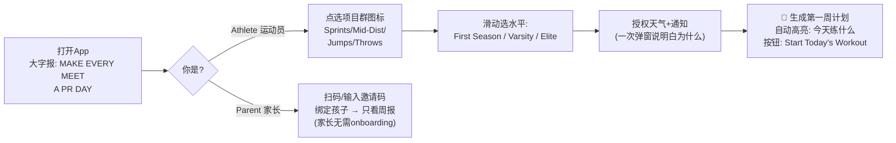
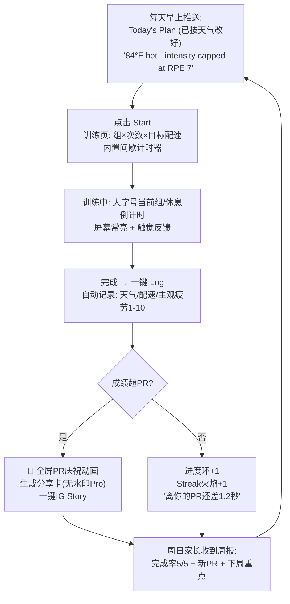
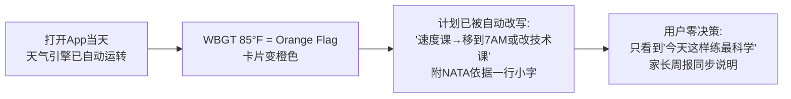
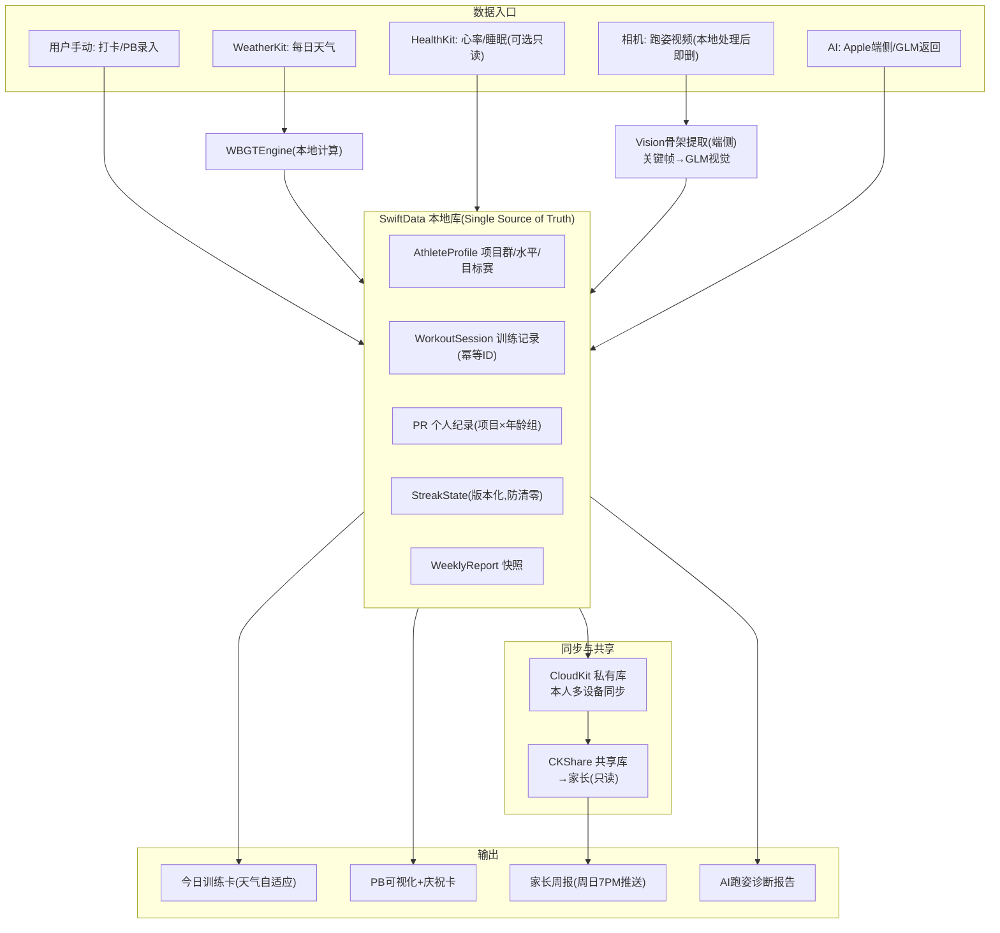
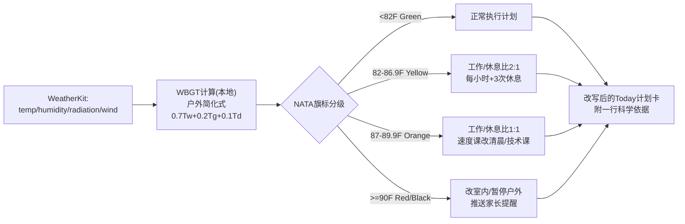

# TR-20261013-田径训练PRDay-操作指南

> **项目名称（App 名）**：**PRDay**
> **副标题（Subtitle，30字符内）**：Track Training That Adapts
> **目标市场**：🇺🇸 美国初中/高中/大学田径运动员及其家长（全英文界面）
> **对标竞品**：3AK Track（月收入约 $20K 验证）——本文档全部内容均为「复刻 + 痛点碾压升级」方案
> **文档目的**：让任何 LLM/开发者阅读本文档后，都能从零复刻出一款极具竞争优势的 iOS 田径训练 App
> **文档日期**：2026-10-13
> **命名合规声明**：PRDay 已核实在 Apple App Store 无同名应用；与竞品 3AK Track、TrackIt、V.O2、Runna 等无重名风险（上架前请再以 `apps.apple.com` 搜索最终确认一次）

---

## 〇、命名深度分析（病毒式传播设计）

### 0.1 候选名对比与终选

| 候选名 | ASO搜索 | 品牌记忆度 | 功能描述性 | 情感共鸣 | 淘汰/入选原因 |
|---|---|---|---|---|---|
| **PRDay** ✅ | "PR" 是美国田径圈搜索高频词（personal record / PR） | ★★★★★ 5个字母，一次听懂 | 中（靠副标题补齐） | ★★★★★ "PR Day" 是美国运动员赛后发帖的欢呼词（"PR DAY!!!"） | **终选** |
| PRFactory | PR 搜索词 OK | ★★★ | 中 | ★★ | 已有同名摩托用品店/影视公司，商标风险 |
| TrackSpark | 一般 | ★★★ | 高 | ★★ | 已有 trackspark.com 网站在用，冲突 |
| TrackDay | 一般 | ★★★★ | 高 | ★★ | 与赛车 "Track Day" 术语强绑定，混淆 |
| VDOT类/教练名类 | 高 | ★ | 高 | ★ | 像工具不像品牌，无传播性 |

### 0.2 为什么 PRDay 能像病毒一样传播

1. **它本身就是用户会说的话**：美国田径运动员在比赛刷新个人纪录（PR）后，会在 Instagram/TikTok 配文 "PR Day!"。App 名 = 用户的情绪高潮时刻 = 免费的自传播媒介。每次比赛日，用户发帖自带品牌名。
2. **口号内置**：营销主线口号直接用 **"Make every meet a PR Day."**（让每次比赛都成为 PR Day）——品牌、功能承诺、情绪价值三合一。
3. **ASO 结构**：名称 `PRDay`（短、易拼、易搜）+ 副标题 `Track Training That Adapts`（覆盖 track / training 关键词）+ 关键词字段填 `track,field,sprint,xc,cross country,workout,coach,timer,pace,meet`。
4. **社交分享内建**（详见第 12 节）：每次 PB 自动生成 PR 庆祝卡（配时速/项目/进步幅度），一键分享到 Instagram Story —— 每张卡片右下角都是 PRDay 水印。
5. **国际适配**：PR 在全球田径/健身圈通用（英语区全部认识），无文化歧义；5 字母在各国语言里都好念。
6. **红线自查**：不带冒号、不用"主词：副词"、不与任何竞品重名、不侵犯 3AK/TrackIt/Runna 等既有商标。

---

## 一、竞品与痛点研究结论（调研实证）

### 1.1 竞品 3AK Track 情报（复刻对象）

| 维度 | 情报 |
|---|---|
| 收入验证 | 上线首月 $10K → 2个月 $45K → 现 MRR $17-19K（约 $20K/月），Starter Story 2026-06 实地报道 |
| 创始团队 | 2名19-20岁大学生 D1 运动员，零编程背景，无代码搭建，靠 15 万 Instagram 粉丝冷启动 |
| 用户规模 | 50,000+ 用户，App Store 4.8★ / 827 评 |
| 定价 | 免费 + $6.99周 / $9.99月 / 年费 $59.99→**降到 $29.99 后转化率×3**（关键定价情报：高中生日薪心理线 < $60/年） |
| 额外收入 | 用 Shopify 卖 PDF 训练计划，日入 $100-200（说明"结构化训练计划"本身有独立付费需求） |
| 已知短板 | 步态分析只能上传一次（bug）、连续打卡被重置（bug）、**无家长端**、**无教练/团队端**、**无天气功能**、赛季后流失严重 |

### 1.2 竞品格局与定价对标

| 竞品 | 定价 | 说明 |
|---|---|---|
| 3AK Track | 免费+$29.99-49.99/年 | 直接对标，4.8★ |
| TrackIt: Track & Field | 免费+Pro订阅 | 有天气记录/风速修正/PB时间线，但**只记录不指导**，评分人数极少 |
| V.O2 (VDOTO2) | $14.99/月、$119.99/年 | Jack Daniels 体系，偏成人严肃跑者 |
| Runna（Strava 收购） | $19.99/月、$119.99/年 | 大众跑步计划，差评点：计划"pre-baked"不个性化 |
| Trackster | 免费 | 教练/团队平台，功能陈旧 |
| TeamBuildr / TrainHeroic | $90-280/月 | B2B 教练端，太贵 |
| Future（真人私教） | $199/月 | 高价锚点：我们 $49.99/年 只是它的 1/48 |

### 1.3 六大痛点（按严重度排序，附真实用户原话）

**P1 训练计划一刀切（钻石级）**——新手和州冠军用同一张表
> "the team wants to stick with the same thing everyday… i get really excited when i plan workouts but when i go for practice in the morning, i lose the motivation"
> （团队每天重复同样内容…我精心做的计划到了早晨训练就没了动力）—— r/trackandfield

**P2 教练布置方式落后：白板/PDF/GroupMe（钻石级）**——结构化分发是空白
> "Remind was another one they used, but they all said GroupMe was better for team/group chats"
> （教练靠 GroupMe/Remind 群发消息布置训练）—— r/trackandfield

**P3 PB/成绩记录混乱（金级）**——用户被迫自己写代码解析成绩
> "I created a spreadsheet. I coded a parser to parse through the times"
> （我自己做了个表格，还写了代码去解析成绩）—— r/trackandfield

**P4 高温天气训练指导缺失（金级，本产品差异化核心）**
> "paired with the blazing heat (it felt like it was 95!)… Lots of people tend to scratch the 5k, especially if the weather is not ideal"
> （酷热95℉…天气不好大家都弃赛）—— r/trackandfield
> **权威依据**：NATA 立场声明按 WBGT（湿球黑球温度）分级调整活动（<82°F 正常训练，逐级减量）；NATA 共识要求 14 天热适应期；ACSM WBGT 标准是行业基准。**现有所有竞品无一做 WBGT 自适应训练**——这是碾压点，且是"保护孩子安全"的家长付费理由。
> 竞争对手 Garment/Strava 的名场面级抱怨："Garmin tells you your pace. Strava tells you after the fact. Neither one says 'hey, it's 84° and humid, slow down now or you'll blow up at mile 8.'"

**P5 家长看不到孩子训练（金级）**——家长是付费决策者却完全被排除在外
> 3AK、Runna 均无家长端；Tully（"Know where they're at. Cheer louder."）、LOKR Sports 等新品专门做家长可见性并已验证付费需求，但**均无田径专用方案**。

**P6 升学招募信息混乱、被收割（银级，增值方向）**
> "I used NCSA in high school and paid for the MVP, which was $3600. I was completely ripped off"
> （付了$3600完全被坑）—— r/trackandfield

### 1.4 市场规模与付费意愿

- **NFHS 2024-25**：高中室外田径 **115.8万运动员**（女子第1 + 男子第2），遍及 **17,373 所学校**；中学（初中）规模另计，大盘充足
- **家庭支出**：青少年体育家庭平均 **$1,016/孩子/主项/年**（较2019年 +46%，Project Play 2025）
- **付费意愿**：田径私教 $50-120/节课；$49.99/年 ≈ 半节私教课，家长代付毫无阻力
- **结论**：3AK 已验证"田径专用 App + $30年费"模式成立；我们的任务是 **以家长端 + 天气自适应 + AI 教练 + 教练工作台形成代差碾压**，吃更大的盘

---

## 二、产品定位：PRDay 是什么

**一句话**：PRDay 是美国首款 **"会看天色的田径教练"** —— 每天根据天气（WBGT 热风险）、你的项目和水平、距下场比赛的天数，自动生成并调整训练，家长每周自动收到进步周报，拍视频即可获得 AI 跑姿诊断。

### 2.1 五大碾压点（对 3AK 的代差）

| # | 碾压点 | 3AK 现状 | PRDay 方案 |
|---|---|---|---|
| 1 | **WBGT 天气自适应** | 无 | WeatherKit 实时天气 → WBGT 计算 → 按 NATA/ACSM 分级自动改计划（高温日自动降强度/移到清晨/改室内） |
| 2 | **家长周报** | 无 | CloudKit 家庭共享 + 每周日自动生成周报（完成率/进步/PB），家长零操作可见 |
| 3 | **AI 跑姿诊断** | 有 bug（只能传一次） | 端侧 Vision 骨架提取 + GLM 视觉推理诊断，可反复用，出报告 |
| 4 | **数据可靠性** | 打卡重置/分析限次（差评源） | 本地优先 SwiftData + CloudKit 同步，streak 永不清零；所有任务有降级方案，绝不"卡死" |
| 5 | **个性化引擎** | 一张表走天下 | 按项目群（短跑/中长跑/跳部/掷部）×水平×周期相位生成计划，VDOT/Riegel 算配速 |

### 2.2 功能清单（免费 vs Pro）

| 功能 | 免费（引流） | Pro |
|---|---|---|
| 今日训练（每天1个推荐训练+打卡） | ✅ | ✅（全库） |
| WBGT 热风险旗帜（今日该不该练/怎么练） | ✅ | ✅ |
| PB 记录 | 前3个项目 | 全部项目 |
| 训练计划库（4项目群×12-16周周期化） | ❌ | ✅ |
| 天气自适应改计划 | ❌ | ✅ |
| 家长周报 + 家庭共享 | ❌ | ✅ |
| 比赛日清单（饮食/睡眠/装备/热身） | ❌ | ✅ |
| PR 庆祝卡 | 带水印 | 无水印+定制 |
| AI 跑姿诊断（拍视频） | 每周1次 | 每月8次（GLM 产生成本）；**BYO Key 则无限** |
| AI 教练问答（训练数据解读/调计划） | 每日1次（Apple AI 端侧） | 无限（Apple AI 端侧，付费后免费不限次） |
| Streak/连续训练打卡 | ✅ | ✅ |

---

## 三、软件实现流程图（开发视角：整体架构与实现步骤）

```mermaid
flowchart TB
    subgraph DEV["开发实现流程（MVP 6个里程碑）"]
        M1["M1 基础骨架<br/>SwiftUI + SwiftData 模型<br/>AthleteProfile/Workout/PR/Streak"]
        M2["M2 计划引擎<br/>计划库数据(4项目群×周期化)<br/>VDOT/Riegel 配速计算器"]
        M3["M3 天气自适应<br/>WeatherKit → WBGT引擎<br/>NATA分级 → 计划改写规则"]
        M4["M4 打卡与PB<br/>Streak引擎(防清零)<br/>Swift Charts + PR庆祝卡"]
        M5["M5 家长端<br/>CloudKit CKShare 家庭共享<br/>周报生成+周日推送"]
        M6["M6 AI与付费<br/>Apple Foundation Models(端侧)<br/>GLM视觉跑姿 + RevenueCat"]
        M1 --> M2 --> M3 --> M4 --> M5 --> M6
    end

    subgraph ARCH["运行时架构（本地优先 + 按需云）"]
        UI["SwiftUI 视图层<br/>(Today/Plan/PR/Me 四Tab)"]
        ENG["引擎层（纯本地计算）<br/>PlanEngine / WBGTEngine<br/>PaceEngine / StreakEngine"]
        STORE["SwiftData 本地库<br/>(离线优先,Source of Truth)"]
        CK["CloudKit<br/>(同步+CKShare家庭共享)"]
        AI["AI编排层 AICoachRouter<br/>端侧Apple Intelligence优先<br/>复杂任务→GLM(付费/BYO)"]
        RC["RevenueCat<br/>(StoreKit 2 订阅)"]
        UI --> ENG --> STORE
        STORE <--> CK
        UI --> AI
        AI --> RC
    end
```



**实现规则（编写代码时必须遵守）**：
1. **本地优先（Local-first）**：SwiftData 是唯一 Source of Truth；CloudKit 只做同步与共享。断网时全功能可用（3AK 用户多为在训练场，信号差）。
2. **引擎层零 UI 依赖**：PlanEngine/WBGTEngine/PaceEngine 是纯函数/纯计算 struct，必须可单元测试。
3. **防呆三原则**（把 3AK 的差评做成卖点）：streak 只能被"补卡机制"修复、永不自动清零；AI 分析失败必须有降级方案（端侧分析兜底）；任何写操作幂等（防重复打卡）。
4. **青少年合规**：不收集联系方式、不做社交/feed、健康数据只存 iCloud 私有库；页脚固定 "For training guidance only. Not medical advice."

---

## 四、用户使用流程图（极简爽感设计——本节最重要）

设计总纲：**3步内开跑（Onboarding ≤ 60秒）、每天1次点击完成闭环、任何时刻都能"马上知道该练什么"**。用户感受要像看爽文：每天打开 → 系统已替我安排好 → 一键开始 → 完成即变强 → 变强被看见（PB卡+家长点赞）。

### 4.1 首次启动（60秒开跑）



### 4.2 日常使用循环（爽文节奏：安排→执行→变强→被看见）



### 4.3 天气突变场景（核心差异化体验）



**爽感细节清单（必须实现）**：
- 今日训练永远在首屏第一张卡，打开即见，无需任何导航
- 所有数字用超大字号（体育记分牌风格），当前训练中屏幕常亮
- PR 庆祝是全屏撒彩带 + 触觉重击（UINotificationFeedbackGenerator .success），这是用户最想炫耀的时刻，绝不能省
- 家长端没有"使用"概念：装上→绑定→每周日 7PM 收到推送，点开是一张精美周报卡，**零学习成本**
- 每个需要授权的弹窗都先说"为什么"（"We check the heat so practice never wrecks you"）

---

## 五、软件数据流图（数据正确性设计——本节最重要之二）

### 5.1 总数据流（本地优先 + 同步 + 共享）



### 5.2 关键数据正确性规则（防 3AK 式 bug）

| 风险 | 规则（必须实现） |
|---|---|
| 打卡重复/丢失 | WorkoutSession 用 `clientUUID` 作唯一键，写库前 upsert；本地写成功才更新 UI |
| Streak 清零（3AK 差评） | StreakState 带版本号+审计事件（只追加不覆盖）；断练日走"修复问卷"（3个内可补卡）而非直接清零 |
| 天气服务失败 | WBGT 引擎降级链：WeatherKit → 最近缓存（≤3h） → 仅温度粗算 → 显示"以教练安排为准"，绝不空白 |
| AI 服务失败 | 跑姿诊断：GLM 超时/失败 → 端侧骨架特征报告兜底（膝角/躯干前倾/触地时间），永不"转圈后无响应" |
| 家长数据越权 | CKShare 中家长是 readOnly participant；孩子健康明细（心率）默认不进共享库，只共享训练完成度与PB |
| 多设备冲突 | CloudKit 冲突以"最新修改时间+字段级合并"解决；PR 记录取更优值 |

### 5.3 WBGT 天气自适应数据流（核心逻辑）



---

## 六、核心技术实现代码示例

### 6.1 数据模型（SwiftData）

```swift
import SwiftData

enum EventGroup: String, Codable, CaseIterable {
    case sprints = "Sprints"        // 100m/200m/400m/ hurdles
    case midDistance = "Mid-Dist"   // 800m/1600m/3200m
    case jumps = "Jumps"            // LJ/HJ/TJ/PV
    case throwsEvent = "Throws"     // Shot/Discus
}

@Model final class AthleteProfile {
    var eventGroup: EventGroup
    var level: Level            // firstSeason / varsity / elite
    var goalRace: String        // 目标比赛
    var raceDate: Date?
    var onboardingCompleted: Bool
    init(eventGroup: EventGroup, level: Level) { ... }
}

@Model final class WorkoutSession {
    @Attribute(.unique) var clientUUID: UUID   // 幂等键,防重复打卡
    var date: Date
    var planDayID: String                      // 对应计划中的某一天
    var completed: Bool
    var rpe: Int                               // 主观疲劳1-10
    var actualPaceSecPerMile: Double?
    var wbgtAtWorkout: Double?                 // 训练时热指数留档
    var weatherSummary: String?
}

@Model final class PersonalRecord {
    var event: String          // "100m", "1600m", "LongJump"
    var mark: Double           // 秒 或 米
    var achievedAt: Date
    var windAssisted: Bool     // 风速超规不算正式PR
}

@Model final class StreakState {
    var currentStreak: Int
    var longestStreak: Int
    var version: Int                            // 只增不减
    // 修复问卷/补卡以 StreakEvent(append-only) 记录,永不直接清零
}
```

### 6.2 WBGT 引擎 + NATA 分级（纯本地计算，无版权问题——公式为公开标准）

```swift
struct WBGTResult { let wbgtF: Double; let flag: HeatFlag }

enum HeatFlag: String {
    case green, yellow, orange, red, black
    var activityRule: String {
        switch self {
        case .green:  return "Normal activities"
        case .yellow: return "Work:rest 2:1, +3 rest breaks/hour"
        case .orange: return "Work:rest 1:1, move speed work to early AM"
        case .red:    return "Indoor only, minimal outdoor"
        case .black:  return "Suspend outdoor practice"
        }
    }
}

enum WBGTEngine {
    /// 户外简化式（日本气象厅/Tokyo 2020 采用,公开公式）:
    /// WBGT = 0.567*Ta + 0.393*e + 3.94  (Ta:°C, e:水汽压hPa)
    static func compute(tempF: Double, humidity: Double) -> WBGTResult {
        let taC = (tempF - 32) / 1.8
        // 饱和水汽压 Tetens 公式 → 实际水汽压
        let es = 6.105 * exp(17.27 * taC / (237.7 + taC))
        let e  = es * humidity / 100
        let wbgtC = 0.567 * taC + 0.393 * e + 3.94
        let wbgtF = wbgtC * 1.8 + 32
        return WBGTResult(wbgtF: wbgtF, flag: classify(wbgtF: wbgtF))
    }
    /// NATA/ACSM 公开阈值分级
    static func classify(wbgtF: Double) -> HeatFlag {
        switch wbgtF {
        case ..<82:        return .green
        case 82..<87:      return .yellow
        case 87..<90:      return .orange
        case 90..<92.2:    return .red
        default:           return .black
        }
    }
}
```

### 6.3 天气自适应规则引擎（把"84°F别硬撑"做成产品）

```swift
struct PlanAdjustmentEngine {
    /// 输入: 原始计划日 + 天气 + 距比赛天数 → 输出改写后的今日训练
    static func adjust(day: PlanDay, flag: HeatFlag, daysToRace: Int) -> PlanDay {
        var d = day
        switch flag {
        case .green:
            break
        case .yellow:
            d.workRestRatio = "2:1"; d.extraBreaksPerHour = 3
        case .orange:
            d.workRestRatio = "1:1"
            if d.intensity == .high {
                d.title = "Technique day (heat-adjusted)"
                d.note = "Speed session moved to 7 AM or swapped to drills — NATA Orange Flag"
            }
        case .red, .black:
            d.indoorOnly = true
            d.note = "Outdoor practice suspended — heat flag \(flag.rawValue)"
        }
        // 赛前周减量(taper): 距比赛<=7天 高强度课减40%量
        if daysToRace <= 7 && d.intensity == .high { d.volumeScale = 0.6 }
        return d
    }
}
```

### 6.4 配速引擎：VDOT + Riegel（公开公式，自实现无版权风险）

```swift
enum PaceEngine {
    /// Riegel 公式: t2 = t1 * (d2/d1)^1.06 —— 用已知PR推算任意距离等价成绩
    static func riegel(t1Sec: Double, d1Meters: Double, d2Meters: Double) -> Double {
        t1Sec * pow(d2Meters / d1Meters, 1.06)
    }
    /// E/M/T/I/R 五区间配速（Jack Daniels 体系公开概念）:
    /// Easy = 等价 marathon pace * 1.15~1.25；Interval(R) = 当前1英里PR pace 等
    /// 完整 VDOT 表在 App 内以常量表内置（数值来自公开跑步科学文献常见表）
    static func trainingPaces(fromPR prSec: Double, meters: Double) -> TrainingPaces {
        let vdotVDOT = estimateVDOT(prSec: prSec, meters: meters)
        return TrainingPaces(easy: ..., marathon: ..., threshold: ..., interval: ..., rep: ...)
    }
}
```

### 6.5 AI 跑姿诊断：端侧 Vision 骨架 + GLM 视觉（OpenAI 兼容）

```swift
import Vision

final class FormAnalyzer {
    /// 第一步:端侧逐帧提取19个2D关节点(免费,离线,零成本)
    func extractFrames(from url: URL) async throws -> [PoseFeatures] {
        let asset = AVURLAsset(url: url)
        let generator = AVAssetImageGenerator(asset: asset)
        generator.appliesPreferredTrackTransform = true
        var features: [PoseFeatures] = []
        for t in stride(from: 0.5, to: 6.0, by: 0.5) {   // 抽6秒,每0.5s一帧
            let cgImage = try generator.copyCGImage(at: CMTime(seconds: t, preferredTimescale: 600),
                                                    actualTime: nil)
            let request = VNDetectHumanBodyPoseRequest()
            try VNImageRequestHandler(cgImage: cgImage).perform([request])
            if let pose = request.results?.first {
                features.append(PoseFeatures(pose: pose, time: t))  // 算膝角/躯干前倾/触地
            }
        }
        return features
    }

    /// 第二步:特征帧(标注骨架线的小图)交 GLM 视觉模型生成诊断
    /// GLM 接口为 OpenAI 兼容格式,可用统一 LLMClient 支持多模型
    func diagnose(frames: [PoseFeatures], key: String) async throws -> String {
        let client = LLMClient(endpoint: "https://api.z.ai/api/paas/v4/chat/completions",
                               apiKey: key)          // 国际版端点,美国用户直连
        let system = """
        You are an elite track & field form coach. Analyze the annotated skeleton
        frames (knee angle, trunk lean, ground contact). Output: 3 strengths,
        3 fixes with drills, one-line safety note. Keep under 180 words.
        """
        return try await client.chat(model: "glm-5.3-flash",
                                     system: system,
                                     images: frames.map { $0.annotatedJPEGBase64 })
    }
}
```

### 6.6 多模型 LLM 客户端（BYO Key：GLM/OpenAI/Claude/Gemini/DeepSeek/自定义，严禁写死单一模型）

```swift
struct AIProvider: Codable, Identifiable {
    var id: String              // "glm" / "openai" / "claude" / "gemini" / "deepseek" / custom
    var label: String
    var endpoint: String        // OpenAI 兼容 base URL
    var defaultModel: String
    var supportsVision: Bool
}

enum ProviderCatalog {
    static let builtin: [AIProvider] = [
        .init(id: "glm",     label: "GLM",     endpoint: "https://api.z.ai/api/paas/v4",      defaultModel: "glm-5.3-flash", supportsVision: true),
        .init(id: "openai",  label: "OpenAI",  endpoint: "https://api.openai.com/v1",         defaultModel: "gpt-4o-mini",   supportsVision: true),
        .init(id: "claude",  label: "Claude",  endpoint: "https://api.anthropic.com/v1",      defaultModel: "claude-sonnet", supportsVision: true),
        .init(id: "gemini",  label: "Gemini",  endpoint: "https://generativelanguage.googleapis.com/v1beta/openai", defaultModel: "gemini-2.0-flash", supportsVision: true),
        .init(id: "deepseek",label: "DeepSeek",endpoint: "https://api.deepseek.com/v1",       defaultModel: "deepseek-chat", supportsVision: false),
    ]
    // + 用户自定义: 自填 endpoint/model/apiKey
    // Key 存 iOS Keychain,绝不上传服务器、绝不进 CloudKit
}
```

### 6.7 Apple Intelligence（端侧）优先路由

```swift
import FoundationModels   // iOS 26 Apple Intelligence 端侧框架(免费,无token成本)

final class AICoachRouter {
    enum Task { case weeklySummary, planTweak, formDiagnosis, chatQA }

    /// 路由规则: 端侧优先(免费) → 复杂任务且已付费/BYO → GLM
    func route(_ task: Task, entitlement: Entitlement) -> Backend {
        switch task {
        case .weeklySummary, .chatQA:
            return .appleOnDevice                 // 免费,付费用户无限次
        case .planTweak, .formDiagnosis:
            if entitlement.hasBYOKey { return .byoProvider }      // 用户自己的Key→无限
            if entitlement.isPro { return .glmMetered }           // Pro含额度(如8次/月)
            return .upsell                                        // 免费层仅限次
        }
    }
}
```

### 6.8 CloudKit 家长共享（参考 apple/sample-cloudkit-sharing，MIT）

```swift
// 家长绑定: 生成 CKShare,家长为 readOnly participant
func createFamilyShare() async throws -> CKShare {
    let zone = try await container.privateCloudDatabase.databaseScope...
    let report = fetchOrCreateWeeklyReportRoot()   // 共享的"周报根记录"
    let share = CKShare(rootRecord: report)
    share[CKShare.SystemFieldKey.title] = "\(name)'s PRDay Weekly" as CKRecordValue
    share.publicPermission = .none                 // 仅受邀者
    let result = try await container.privateCloudDatabase.modifyRecords(
        saving: [report, share], deleting: [])
    return share
}
// 家长端: 接受 UICloudSharingController 邀请 → 只读订阅周报变更 → 周日7PM本地推送
```

### 6.9 订阅门控（RevenueCat，把 GLM 消耗型成本隔离）

```swift
enum Entitlement {
    case free, pro
    var glmMonthlyQuota: Int { self == .pro ? 8 : 1 }        // GLM是消耗品→额度制
    var appleAIUnlimited: Bool { self == .pro }               // 端侧免费→付费无限
    var hasBYOKey: Bool { Keychain.hasAnyProviderKey }        // BYO→AI功能全解锁
}

func canRunGLM(_ e: Entitlement, usedThisMonth: Int) -> Bool {
    usedThisMonth < e.glmMonthlyQuota || e.hasBYOKey          // 额度尽→引导BYO或等下月
}
```

---

## 七、可二次开发的开源项目参考（已核实 license）

| 项目 | Stars | License | 用途 | 合规说明 |
|---|---|---|---|---|
| **apple/sample-cloudkit-sharing** | 333 | MIT | 家长端 CKShare 完整示例（UICloudSharingController 包装、async/await） | ✅ 可直接二开 |
| **apple/sample-cloudkit-sync-engine** | 270 | MIT | 本地优先同步引擎骨架 | ✅ 可直接二开 |
| **StanfordBDHG/HealthGPT** | 1965 | MIT | HealthKit 读取 + OpenAI 兼容 LLM 客户端（SwiftOpenAI）→ 指向 GLM 端点即用 | ✅ 可直接二开 |
| **RevenueCat/purchases-ios** | 3077 | MIT | StoreKit 2 订阅管理事实标准 | ✅ 直接集成 |
| **OpenTracksApp/OpenTracks** | 1402 | Apache-2.0 | 训练/轨迹数据模型参考（Track/Trackpoint/Marker） | ✅ 仅参考数据模型平移到 SwiftData |
| **google-ai-edge/mediapipe** | 37250 | Apache-2.0 | Pose Landmarker（33关节，iOS 示例），比 Vision 19关节更精细的备选 | ✅ 可选集成 |
| wger-project/wger | 7108 | AGPL-3.0 | 训练计划库字段设计参考 | ⚠️ 传染性license，**只参考结构不拷代码** |
| Runalyze/Runalyze | 226 | 无license | VDOT/TRIMP/训练负荷算法规格参考 | ⚠️ 不拷代码，只参考公式 |
| GoldenCheetah/GoldenCheetah | 2230 | GPLv2 | CTL/ATL/TSB 疲劳管理算法参考 | ⚠️ 只参考算法 |
| kwodzicki/pywbgt | 13 | GPLv3 | WBGT 计算公式参考 | ⚠️ 公式为公开标准，自实现最安全 |

**结论**：核心骨架全部用 MIT/Apache 项目可商用二开；GPL/AGPL/无license 项目一律只参考算法与数据结构。图表用系统 Swift Charts，零第三方依赖。

---

## 八、Apple AI + GLM 组合策略（成本与体验双最优）

| 功能 | 首选引擎 | 原因 | 降级链 |
|---|---|---|---|
| AI 教练问答（解读本周数据） | Apple Intelligence 端侧（Foundation Models） | 免费、隐私、离线可用 → **付费用户无限次** | 失败→本地模板文案 |
| 家长周报生成 | Apple 端侧 | 每周1次/人，端侧零成本 | 模板渲染兜底 |
| 计划微调建议 | Apple 端侧 | 简单推理足够 | 规则引擎兜底（纯本地） |
| **AI 跑姿诊断（视觉）** | **GLM-5.3-Flash 视觉**（端侧 Vision 只做骨架提取） | 需要强视觉推理才能碾压竞品的"只能传一次"bug功能 | 端侧骨架特征报告兜底 |
| 深度训练复盘/赛季规划 | GLM-5.3-Flash 推理 | 复杂推理质量决定口碑 | 端侧 |

**路由原则**：凡端侧能做的绝不上云（成本=0）；凡 GLM 出场的必是"竞品做不到或做不好"的体验点。GLM 为消耗型 API（配置见下方仓库，按 glm api config skill 标准接入：`https://github.com/asunnyboy861/GLM-Cloudflare`，私有仓库 gh 已认证可访问，前端现成多模型 BYO 模块配套，无需重复开发；API 文档 `https://docs.bigmodel.cn`；面向美国用户走国际版端点 `api.z.ai`，Key 体系已统一）。**因此：GLM 相关功能严禁一次性买断，必须额度制或 BYO Key；Apple 端侧 AI 功能付费后可无限使用。**

> ⚠️ **发布前必须完成的配置**：需要接入 GLM-5.3-Flash API Key（跑姿诊断与深度复盘功能的动力源）。**请向项目负责人索取 GLM API Key 并配置到 Cloudflare Worker 端（按 glm api config skill 标准），客户端经 Worker 中转调用，Key 永不落盘用户设备。**

---

## 九、价格策略（详细，已按市场验证数据设计）

**定价铁律**（来自调研）：① 3AK 年费 $59.99→$29.99 转化×3 → 高中生心理线 < $60/年；② GLM 是消耗品 → **GLM 功能禁止买断**；③ Apple 端侧 AI 免费 → 可无限送；④ BYO Key 必须多模型+自定义，严禁写死单一 BYO 模型。

### 策略 a：完全免费档（引流）
- 今日训练（每天1个推荐）、WBGT 热风险旗帜、3 个项目的 PB 记录、Streak 打卡、PR 庆祝卡（带水印）
- AI：AI 教练问答 1次/天（Apple 端侧，成本0）、跑姿诊断 1次/周（GLM，拉体验钩子）
- 目的：让用户 7 天内体验到"天气改计划+跑姿诊断"两个爽点

### 策略 b：下载前付费买断 —— ❌ 本项目不适用
理由：核心卖点含 GLM 消耗型 API，买断无法覆盖成本。此档仅当未来推出纯本地轻量版（如 PRDay Lite）时启用（参考定价 $9.99 买断，吃付费榜红利——Tarsi 已验证付费榜竞争小）。

### 策略 c+d：站内订阅（主模式，合并执行）
**PRDay Pro — $7.99/月 或 $49.99/年（7天免费试用，≈一顿快餐，"两节私教课的钱用一年"）**

| Pro 权益 | 说明 | 成本属性 |
|---|---|---|
| 全部计划库 + 天气自适应 | 核心价值 | 纯本地，零边际成本 |
| 家长周报 + 家庭共享 | 家长付费决策者的直达触点 | CloudKit，近零成本 |
| Apple AI 功能无限次 | 端侧免费 | 零边际成本 |
| 比赛日清单 + 无水印PR卡 | 情绪价值 | 零成本 |
| GLM 跑姿诊断 8次/月 | Pro 内含额度（防滥用） | 消耗型→额度制 |
| **BYO Key 模式** | 填入 GLM/OpenAI/Claude/Gemini/DeepSeek/自定义任一 Key → AI 跑姿诊断+深度复盘**无限次** | 成本转嫁→可"无限" |

**为何不设终身买断**：GLM 额度是持续成本；终身买断会让 8 次/月的视觉分析变成亏损黑洞。替代方案：不提供买断，但年费 $49.99 定价本身已传达"一次性付清"的爽感。

**转化设计**：免费层每周1次跑姿诊断 → 第2次即触达付费墙（体验过才知道碾压级差距）；家长周报只在 Pro（家长为孩子的成绩付费意愿 > 运动员本人，且家长决策链短）；年付默认选中 + 月付并列展示（透明定价，杜绝 3AK 同类"月付被扣年费"差评）。

---

## 十、UI 设计规范（美国市场主流审美）

**风格关键词**：Scoreboard（记分牌）/ Varsity（校队）/ Nike Training——大字报、高对比、运动感，而非可爱风。

1. **配色**：暗色主调（近黑 `#0B0F14`）+ 电光主色（竞速橙 `#FF6B2C` 或荧光绿 `#C6FF3D` 二选一作为品牌色）+ 语义色（热风险旗帜：绿/黄/橙/红/黑 直接复用到 UI 主视觉）。
2. **字体**：系统 SF Pro，标题用超大号（`largeTitle` ×1.5）+ 等宽数字（`.monospacedDigit()`）呈现成绩/配速——记分牌质感。
3. **四 Tab 结构**：`Today`（今日训练+热风险旗，首屏即训练卡）/ `Plan`（周视图+周期进度）/ `PRs`（项目×时间线+PB曲线 Swift Charts）/ `Me`（档案/家长绑定/订阅/BYO AI 设置）。
4. **组件规范**：训练中界面屏幕常亮（`isIdleTimerDisabled`）、按钮最小 44pt、主 CTA 每屏唯一且用胶囊大按钮；触觉反馈贯穿（开始/完成/PR 三档强度）。
5. **零学习成本原则**：Onboarding 全部点选无打字；每日核心路径 ≤ 2 次点击（打开→Start）；一切"为什么"用一行小字内联解释，不弹教程。
6. **家长端**：极简白底卡片风（与运动员端区分），周报是一张可转发的图卡（IG/短信场景优化 9:16）。
7. **合规元素**：训练指导免责声明常驻页脚；热风险红色档家长推送属于安全功能（家长端最大卖点，文案克制不恐吓）。

---

## 十一、增长与 ASO

- **ASO**：名称 `PRDay` + 副标题 `Track Training That Adapts`；关键词 `track,field,sprint,cross country,xc,workout,pace,timer,coach,meet,heat`；截图前3张 = 今日训练卡（热风险旗）/PR庆祝动画/AI跑姿报告。
- **内容引擎（抄 3AK 作业并升级）**：TikTok/IG 矩阵账号发"高温天训练翻车 vs PRDay 帮你改计划"对比视频；赛后季（4-6月州锦标赛 + 秋季 XC）是投放/内容高峰。
- **内建传播**：PR 卡水印、家长周报转发卡、教练分享链接（教练推荐新团队→老用户裂变）。
- **合规**：青少年用户不做社交 feed、不收集联系方式；App 隐私标签"数据不与第三方共享"（相对竞品的信任优势）。

---

## 十二、开发里程碑与验收

| 里程碑 | 内容 | 验收标准 |
|---|---|---|
| M1（第1周） | 骨架+数据模型+四Tab | 断网全功能可用；打卡幂等 |
| M2（第2周） | 计划引擎+配速引擎 | 4项目群×12周计划可生成；VDOT单测通过 |
| M3（第2-3周） | WBGT引擎+自适应 | 模拟5种天气输入→5种计划改写正确 |
| M4（第3周） | Streak+PR+庆祝卡 | Streak任何操作不清零；PR动画60fps |
| M5（第4周） | CloudKit家长共享+周报 | 家长只读可见；周日推送准时 |
| M6（第5-6周） | AI路由+GLM视觉+RevenueCat+TestFlight | GLM失败有端侧兜底；订阅/恢复购买正常 |

---

## 十三、风险与合规清单

1. **青少年合规**：面向13+，无社交、无聊天、无UGC；遵守 COPPA 思路最小化收集；健康数据仅 HealthKit 只读+iCloud 私有库。
2. **健康免责**："For training guidance only. Not medical advice."；热风险红色档文案用"遵循你的学校/教练/学区的官方高温政策"（NATA 分级是参考非指令）。
3. **GLM 成本护栏**：额度制（8次/月）+ 结果缓存（同帧特征不重复计费）+ 恶意调用限频；Worker 中转层按 glm api config skill 标准配置限额。
4. **竞品风险**：3AK 迭代快（团队懂用户），需在 6 个月内建立"天气+家长+AI"三重护城河并快速积累评论资产。

---

## 附：给任意 LLM 的复刻简报（TL;DR）

> 用 SwiftUI + SwiftData（本地优先）+ CloudKit（同步与家庭共享）+ WeatherKit + Swift Charts + RevenueCat + Apple Foundation Models（端侧AI）+ GLM-5.3-Flash 视觉（跑姿诊断，经 Cloudflare Worker 中转）复刻并超越 3AK Track。核心差异化：①WBGT 热风险分级自动改训练计划（NATA/ACSM 公开标准）；②家长只读周报（CKShare）；③AI 跑姿诊断（端侧 Vision 骨架 + GLM 视觉）；④Streak 永不清零的可靠性。定价：免费引流档 + Pro $7.99/月 / $49.99/年订阅（无买断，GLM 为消耗品）；BYO 多模型 Key（GLM/OpenAI/Claude/Gemini/DeepSeek/自定义）解锁无限 AI。命名 PRDay（App Store 无重名），口号 "Make every meet a PR Day."。技术参考开源：apple/sample-cloudkit-sharing、HealthGPT、purchases-ios（均 MIT）；GPL/AGPL 项目仅参考算法。

---

*本文档生成：2026-10-13 ｜ 调研来源：Starter Story / MRR Story / Reddit r/trackandfield / App Store / NFHS / Project Play / NATA/ACSM 公开文献 / GitHub ｜ 复刻对象情报：3AK Track（验证收入$20K/月）*
